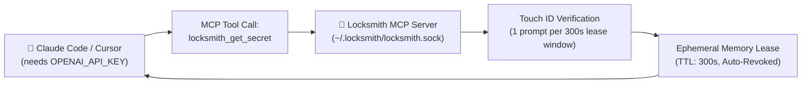

# Recipe: Zero-Plaintext MCP Secret Injection for Claude Code & Cursor

> **Use Case ID:** `LCK-UC-02`  
> **Target Audience:** AI Agent Developers, Cursor & Claude Desktop Users  
> **Platform Engine:** Model Context Protocol (MCP) & Ephemeral Leases  

---

## 1. Problem Statement

Autonomous AI coding agents (Claude Code, Cursor, Antigravity) frequently require API tokens to test integrations, call LLM APIs, or access cloud databases. Traditionally, developers paste cleartext API keys into `.env` files or JSON configurations (`claude_desktop_config.json`, `.cursor/mcp.json`). 

These files frequently get committed to GitHub accidentally, cached in agent session transcripts, or harvested by malicious npm post-install scripts.

---

## 2. When to Use This

Use **Locksmith MCP Secret Injection** when integrating secrets with Claude Desktop, Claude Code CLI, or Cursor. Locksmith exposes an MCP server running locally. The agent requests temporary credential access; Locksmith requests user biometric approval once, issues an ephemeral lease with a 300s TTL, and injects the credential dynamically without touching disk.

---

## 3. Architecture & Dataflow



---

## 4. Prerequisites

1. **Locksmith Installed:** `brew install bonjoski/locksmith/locksmith`.
2. **Locksmith Daemon Active:** `locksmith daemon start`.
3. **Claude Desktop or Cursor:** Installed on workstation.

---

## 5. Step-by-Step Recipe

### Step 1: Add Locksmith MCP Server to Claude Desktop
Add to `~/Library/Application Support/Claude/claude_desktop_config.json`:
```json
{
  "mcpServers": {
    "locksmith": {
      "command": "locksmith",
      "args": ["agent"]
    }
  }
}
```

### Step 2: Add Locksmith MCP Server to Cursor
In `.cursor/mcp.json` (workspace or global):
```json
{
  "mcpServers": {
    "locksmith": {
      "command": "locksmith",
      "args": ["agent"]
    }
  }
}
```

### Step 3: Use Secrets from the AI Assistant
Prompt your assistant:
> *"Please fetch the staging database token using Locksmith and verify the database migration."*

Claude/Cursor invokes `locksmith_checkout_lease(secret_name="STAGING_DB_TOKEN")`. Locksmith presents a single Touch ID prompt. The agent receives the secret for 300 seconds, conducts the migration, and the lease expires automatically.

---

## 6. Verification & Expected Output

Verify active leases in Locksmith Cockpit or CLI:
```bash
locksmith env --status
```
Expected output:
```text
🔐 Locksmith Active Ephemeral Leases:
├── Lease ID:   lck_lease_8f29ab01
│   Secret:     STAGING_DB_TOKEN
│   Client PID: 49102 (Cursor / MCP)
│   TTL:        240s remaining (Expires in 4m 00s)
│   Status:     ACTIVE
Total Active Leases: 1
```

---

## 7. Security Invariants & Blast Radius

- **No Plaintext on Disk:** The secret is never written to a `.env` file or local configuration.
- **Biometric Amortization:** The user is prompted once via Touch ID. Subsequent secret reads by the agent within the 300s lease window proceed without interrupting the developer.
- **Instant Revocation:** If the agent behaves anomalously, the developer can revoke all active leases instantly:
  ```bash
  locksmith env --revoke-all
  ```

---

## 8. Troubleshooting & Common Pitfalls

- **Issue:** Cursor reports `MCP server 'locksmith' exited with code 1`.  
  **Remediation:** Verify that the Locksmith daemon is running:
  ```bash
  locksmith daemon status || locksmith daemon start
  ```
