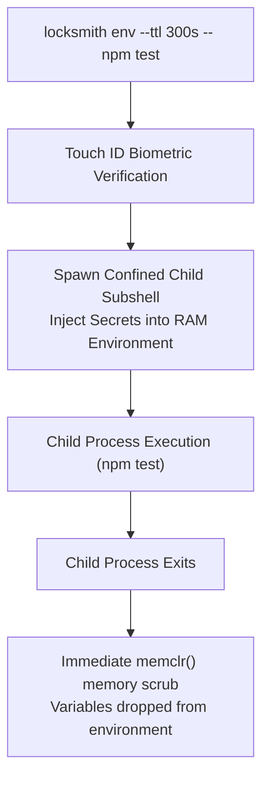

# Recipe: Ephemeral Subshell Environment Injection

> **Use Case ID:** `LCK-UC-03`  
> **Target Audience:** Developers, Script Authors, CI/CD Operators  
> **Platform Engine:** In-Memory Environment Leasing & `memclr` Scrubbing  

---

## 1. Problem Statement

Many build and test scripts expect environment variables (`AWS_ACCESS_KEY_ID`, `DATABASE_URL`, `TOKEN`) to be present in the shell environment. Exporting them manually via `export TOKEN=...` leaves them lingering in shell history, process tables (`ps aux`), and child process inheritance long after the task is finished.

---

## 2. When to Use This

Use **Ephemeral Subshell Injection** when you need to run a CLI tool, migration script, or test suite that expects ambient environment variables. Locksmith prompts for Touch ID, injects the requested secrets into memory, launches a child subshell, and immediately scrubs the variables upon subshell exit.

---

## 3. Architecture & Dataflow



---

## 4. Prerequisites

1. **Locksmith:** Version 1.0+ on `$PATH`.
2. **Secrets Stored:** Secret keys saved via `locksmith add <key>`.

---

## 5. Step-by-Step Recipe

### Step 1: Run a Single Command with Ephemeral Secrets
```bash
# Run deployment script with production credentials injected for 60 seconds
locksmith exec --secret AWS_ACCESS_KEY_ID --secret AWS_SECRET_ACCESS_KEY -- terraform plan
```

### Step 2: Launch an Interactive Subshell with Injected Secrets
```bash
# Spawn an interactive subshell valid for 10 minutes
locksmith env --ttl 600s -- zsh
```
Inside this subshell, all registered vault secrets are available as standard environment variables.

### Step 3: Exit and Verify Cleanup
```bash
exit
```
Once exited back to the parent shell:
```bash
echo $AWS_ACCESS_KEY_ID
```
Emits nothing—the variables were destroyed with the child process.

---

## 6. Verification & Expected Output

Verify that memory was scrubbed after execution:
```bash
locksmith exec --secret TEST_TOKEN -- env | grep TEST_TOKEN
```
Shows the token during execution. Immediately after, querying your parent shell shows nothing:
```bash
env | grep TEST_TOKEN
```
(Exit code 1, no match).

---

## 7. Security Invariants & Blast Radius

- **Process Lifetime Bound:** Injected secrets exist exclusively in the heap and environment table of the child process.
- **No Disk Serialization:** Secrets are never written to disk or swap files.

---

## 8. Troubleshooting & Common Pitfalls

- **Issue:** Child process spawned with `sudo` loses environment variables.  
  **Remediation:** Pass `-E` to preserve environment through sudo:
  ```bash
  locksmith exec --secret MY_KEY -- sudo -E ./install.sh
  ```
