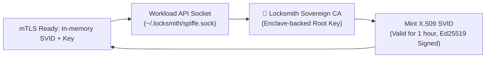

# Recipe: Sovereign Local SPIFFE CA Issuance (X.509 SVIDs)

> **Use Case ID:** `LCK-UC-04`  
> **Target Audience:** Microservice Developers, MicroVM Operators, Cloud Engineers  
> **Platform Engine:** SPIFFE Workload API & In-Enclave CA  

---

## 1. Problem Statement

Developers testing microservices or microVM architectures locally struggle to manage mutual TLS (mTLS). Traditional enterprise PKI systems (SPIRE, HashiCorp Vault) require running distributed container clusters, databases, and external cloud OIDC brokers that overwhelm a local workstation. As a result, developers disable TLS in local dev, leaving traffic unencrypted and violating zero-trust principles.

---

## 2. When to Use This

Use **Locksmith SPIFFE CA** when you need short-lived, cryptographically signed X.509 SVID certificates for local development workloads, Aegisbox microVMs, or containerized services. The root CA private key is generated and secured inside your local hardware Secure Enclave, issuing valid SPIFFE certificates via the standard SPIFFE Workload API over a local Unix domain socket.

---

## 3. Architecture & Dataflow



---

## 4. Prerequisites

1. **Locksmith:** Version 1.0+ on `$PATH`.
2. **SPIFFE Workload Socket Active:** `locksmith ca start`.

---

## 5. Step-by-Step Recipe

### Step 1: Initialize the Sovereign Local CA
```bash
locksmith ca init --trust-domain local.dev
```

### Step 2: Issue an X.509 SVID Certificate
```bash
# Mint a 1-hour SVID certificate for a local microservice
locksmith ca issue \
  --spiffe-id "spiffe://local.dev/ns/dev/sa/payment-service" \
  --ttl 1h \
  --out cert.pem \
  --key-out key.pem
```

### Step 3: Run Workload with mTLS
Pass the certificates to your local server or microVM:
```bash
go run server.go --cert cert.pem --key key.pem
```

---

## 6. Verification & Expected Output

Inspect the issued certificate:
```bash
openssl x509 -in cert.pem -text -noout | grep -E "Subject:|URI:"
```
Expected output:
```text
Subject: CN = payment-service
URI: spiffe://local.dev/ns/dev/sa/payment-service
```

---

## 7. Security Invariants & Blast Radius

- **Short-Lived By Default:** All issued certificates default to a 1-hour maximum lifetime, preventing long-term credential leakage.
- **Root Key Confinement:** The CA signing key never leaves the host's Secure Enclave / TPM.

---

## 8. Troubleshooting & Common Pitfalls

- **Issue:** Workload API reports connection refused on socket.  
  **Remediation:** Verify that the SPIFFE CA daemon is running:
  ```bash
  locksmith ca status || locksmith ca start
  ```
