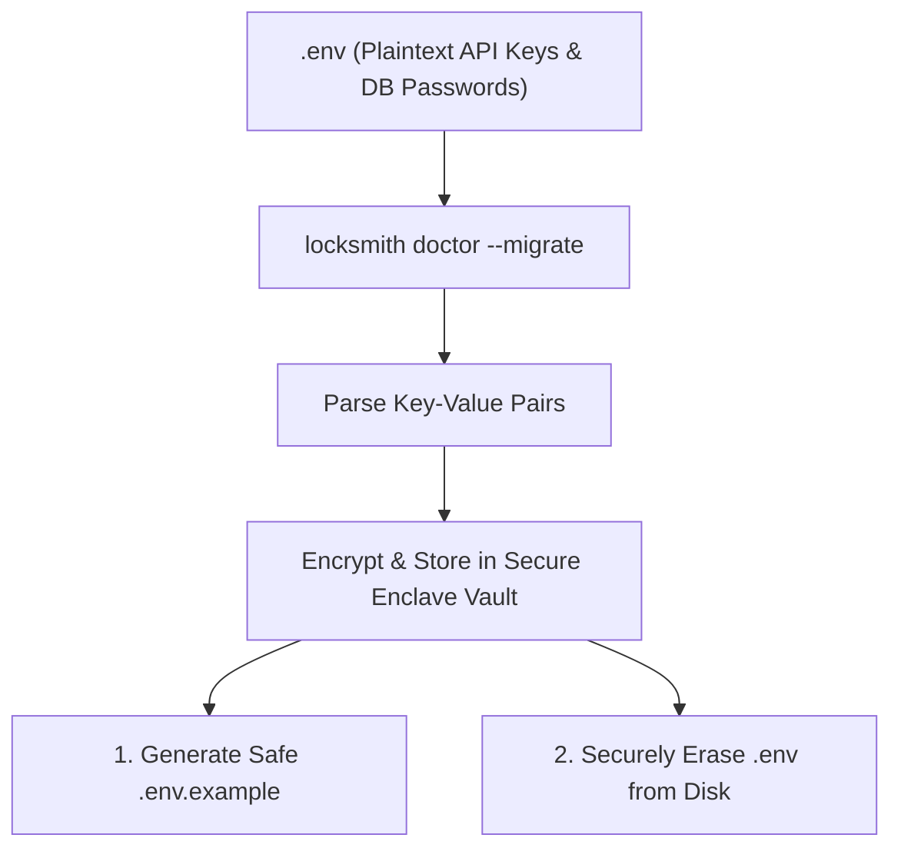

# Recipe: Automated Plaintext `.env` Migration (`locksmith doctor --migrate`)

> **Use Case ID:** `LCK-UC-05`  
> **Target Audience:** Developers Migrating Legacy Codebases, DevSecOps  
> **Platform Engine:** Enclave Vault Migration Engine  

---

## 1. Problem Statement

Legacy repositories routinely accumulate unencrypted `.env`, `.env.local`, or `config.json` files containing live database credentials, Stripe API keys, and cloud tokens. Manually copying dozens of key-value pairs into a secret vault is tedious and error-prone, leading developers to leave plaintext files in place.

---

## 2. When to Use This

Use **`locksmith doctor --migrate`** when onboarding an existing repository or cleaning up technical debt. Locksmith scans your project for plaintext environment files, securely ingests the key-value pairs into the biometric vault, and replaces the sensitive file with a safe reference template (`.env.example`).

---

## 3. Architecture & Dataflow



---

## 4. Prerequisites

1. **Locksmith:** Version 1.0+ on `$PATH`.
2. **Target Project:** Directory containing `.env` or `.env.local`.

---

## 5. Step-by-Step Recipe

### Step 1: Scan and Preview Migration
Run the diagnostic check without mutating files:
```bash
locksmith doctor
```
Expected output:
```text
⚠️ WARNING: Plaintext environment file detected: .env (6 secrets found)
   • STRIPE_SECRET_KEY
   • DATABASE_URL
   • JWT_SIGNING_SECRET
Run 'locksmith doctor --migrate' to securely ingest into biometric vault.
```

### Step 2: Execute Migration
```bash
locksmith doctor --migrate
```
Locksmith prompts for Touch ID to authorize vault storage, encrypts all detected values, securely scrubs `.env`, and generates `.env.example`.

### Step 3: Run Project Seamlessly with Injected Secrets
Now run your project without any plaintext secrets on disk:
```bash
locksmith env -- npm start
```

---

## 6. Verification & Expected Output

Verify that `.env` is removed and secrets exist in the vault:
```bash
ls -la .env*
locksmith list
```
Expected output:
```text
-rw-r--r--  1 user  staff  210 Nov 18 12:00 .env.example

🔐 Vault Keys Registered:
├── STRIPE_SECRET_KEY   [Hardware Biometric]
├── DATABASE_URL        [Hardware Biometric]
└── JWT_SIGNING_SECRET  [Hardware Biometric]
```

---

## 7. Security Invariants & Blast Radius

- **Secure File Erasure:** Plaintext `.env` is wiped from the disk sectors using multi-pass zeroization before deletion.
- **Git Ignore Safeguard:** If `.env` was tracked in git history, Locksmith alerts the user and provides the `git filter-repo` remediation command.

---

## 8. Troubleshooting & Common Pitfalls

- **Issue:** Migration skips custom secret file name like `.env.staging`.  
  **Remediation:** Specify the target file explicitly:
  ```bash
  locksmith doctor --migrate --file .env.staging
  ```
